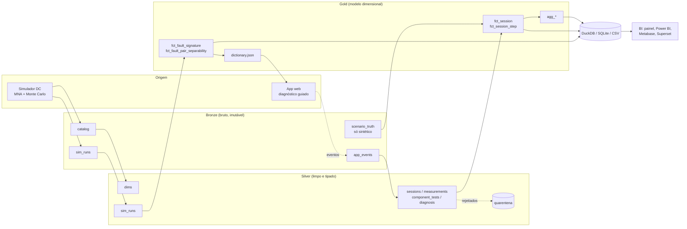
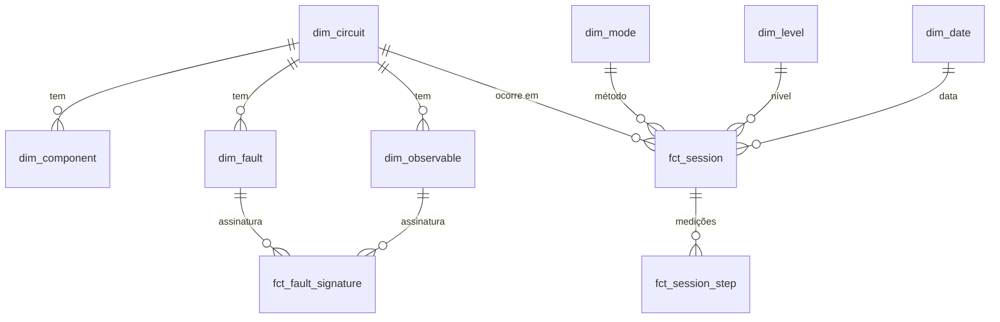

# EletroDiag

Diagnóstico guiado de defeitos em circuitos eletrônicos, construído como um projeto de **engenharia de dados em arquitetura medalhão** (bronze → silver → gold) com uma camada de **BI** no final.

**Demonstração ao vivo:** [app](https://multimetro.wellgois.com/) · [painel de BI](https://multimetro.wellgois.com/painel/)

> **Status:** protótipo funcional com 10 circuitos (5 básicos e 5 blocos de um inversor CC-CA), sem estudantes reais ainda. Todos os números de eficiência deste repositório vêm de **sessões sintéticas** (estudantes simulados com comportamento assumido). Servem para validar a arquitetura e o motor de diagnóstico, não como prova de ganho com estudantes reais. Veja [Limitações](#limitações-e-honestidade).

## O problema e a ideia

Um estudante de eletrônica que não pensa como projetista testa componente por componente até achar o defeituoso. É lento e nem sempre funciona. Um projetista raciocina ao contrário: "se o circuito estivesse certo, este nó teria 5 V; mediu 0,2 V, então o defeito está a montante".

O EletroDiag automatiza esse raciocínio:

1. Cada circuito da biblioteca tem um **dicionário de falhas**: para cada defeito possível (resistor aberto, transistor com coletor em curto, zener degradado...) o simulador calcula as tensões e correntes esperadas, com Monte Carlo para refletir as tolerâncias.
2. O estudante mede onde o app manda e digita a leitura.
3. Um modelo bayesiano compara as leituras com cada defeito, **ranqueia os componentes suspeitos** e **sugere a próxima medição mais informativa** (e mais barata).
4. Cada sessão gera eventos. Esses eventos entram num pipeline medalhão que produz os indicadores de eficiência e a saúde dos dados para um painel de BI.



O dicionário (gold) alimenta o app, e o app gera a telemetria que volta pela bronze. Esse laço é o que torna o projeto um ciclo de dados, não só um app.

## Início rápido

Requisitos: Python 3.11+ (testado em 3.13). Node 18+ só para o teste de paridade do motor JavaScript.

```bash
pip install -r requirements.txt
make demo            # pipeline completo do zero (~25 s), gera app e painel
make test            # 68 testes
```

Sem `make`:

```bash
export PYTHONPATH=src
python -m eletrodiag.pipeline.run --fresh        # tudo, do zero
python -m eletrodiag.pipeline.run --steps silver_events gold_analytics warehouse   # só algumas etapas
python -m eletrodiag.docs.gen_dictionary         # regenera docs/data_dictionary.md
python -m eletrodiag.synth.sensitivity           # regenera docs/sensitivity.md
```

Depois do `make demo`, abra:

| O quê | Onde |
|---|---|
| App de diagnóstico | `app/index.html` (abre direto no navegador; o modo treino sorteia um defeito) |
| Painel de BI | `bi/dashboard/index.html` |
| Warehouse DuckDB | `data/warehouse/eletrodiag.duckdb` |
| Warehouse SQLite | `data/warehouse/eletrodiag.sqlite` |
| CSV e Parquet da gold | `data/gold/csv/` e `data/gold/*.parquet` |

## O que o pipeline processa (execução de exemplo)

| Etapa | Volume |
|---|---|
| Biblioteca | 10 circuitos (5 básicos e 5 blocos de inversor), 73 componentes, 55 pontos de medição, 261 falhas |
| Bronze `sim_runs` | 41.250 simulações (150 Monte Carlo × 275 hipóteses: 265 defeitos + 10 circuitos saudáveis) |
| Silver `sim_runs` | 454.800 linhas, 0 não-convergências |
| Bronze `app_events` | 84.360 eventos de 9.000 sessões, em 8 lotes semanais, com sujeira injetada |
| Silver `sessions` | 8.971 sessões válidas (29 perdidas por linha corrompida do evento inicial) |
| Quarentena | 316 JSON truncados, 232 eventos órfãos, 94 medições sem observável |
| Duplicatas removidas | 1.249 eventos |
| Gold | 17 tabelas + 10 views de BI + `dictionary.json` |
| Qualidade | 29 regras, 0 erros, 7 avisos (todos esperados, ver [data_quality.md](docs/data_quality.md)) |

A sujeira (duplicatas, linhas truncadas, vírgula decimal, unidades misturadas, fusos diferentes) é **injetada de propósito** na bronze para exercitar a silver. Os dados reais do app terão o mesmo esquema ([event_contract.md](docs/event_contract.md)).

## Resultados da simulação

Pareado: cada defeito é "resolvido" pelos três métodos. 8.858 sessões concluídas, 10 circuitos, 265 defeitos (inclui 10 falhas encadeadas), medição de tensão, corrente e teste a frio.

| Método | Sucesso | Troca errada | Passos (média) | Passos (p90) | Tempo (min) |
|---|---|---|---|---|---|
| Componente a componente (método atual) | 79,6% | 17,9% | 4,30 | 9 | 8,5 |
| Ranking do app, medições em ordem aleatória | 87,6% | 8,6% | 4,78 | 11 | 4,2 |
| **Guiado pelo app** | **88,6%** | **8,8%** | **3,88** | **10** | **3,1** |

O que isso **permite** concluir:

- A arquitetura funciona de ponta a ponta e o motor de diagnóstico encontra o componente certo na maior parte dos cenários simulados.
- Nos blocos do inversor (até 15 componentes) o guiado poupa cerca de metade do tempo; em passos, poupa 15% a 30% nos blocos menores, mas **usa mais passos** que o método atual no primário e na ponte H, porque agora pede também testes a frio.
- **O teste a frio (diodo/continuidade com a placa desligada) fechou boa parte da lacuna:** dos 692 pares de defeitos indistinguíveis com a placa ligada, 323 passam a ser separáveis a frio e 378 continuam indistinguíveis nos blocos do inversor (9 nos básicos). Primário push-pull: 67% contra 61% do método atual. **Ponte H: 61% contra 64%, ainda sem vantagem** (diferença dentro do ruído de ~300 sessões por célula).
- **Falhas encadeadas** (ex.: fusível aberto causado por MOSFET em curto) entram como hipóteses com causa e consequência; o app diz para trocar a causa também, e não só o fusível.
- Os 378 pares que restam são sobretudo falhas mascaradas (MOSFET desligado atrás de caminho paralelo pelo diodo de corpo ou enrolamento) e deriva pequena de resistor de gate.
- Existe um **teto de acerto** de origem física: ele é pequeno nos circuitos básicos (9 pares) e grande nos blocos do inversor. O app avisa e manda confirmar com teste de componente.

O que **não** permite concluir: que estudantes reais serão 68% mais rápidos. O tempo depende de uma premissa (testar um componente custa 110 s, medir uma tensão custa 35 s). A [análise de sensibilidade](docs/sensitivity.md) mostra que, se o método atual for perfeito, o app fica abaixo em sucesso (89% contra 97%). A decisão de seguir deve vir de um piloto com estudantes de verdade.

## Camadas e modelo de dados

| Camada | Conteúdo | Regras |
|---|---|---|
| **Bronze** | JSON Lines exatamente como chegou, particionado por `ingest_date` e `batch_id`, com `_manifest.json` (linhas e SHA-256) | append-only, nada é corrigido |
| **Silver** | Parquet tipado, deduplicado, em unidades SI, com chaves únicas | linha inválida vai para a quarentena com o motivo; reconstruível da bronze |
| **Gold** | Modelo dimensional (fatos, dimensões, agregações) e `dictionary.json` | contrato estável para BI |



Detalhes: [architecture.md](docs/architecture.md) e [data_dictionary.md](docs/data_dictionary.md) (gerado dos esquemas reais).

## BI

As views em [`bi/views.sql`](bi/views.sql) escondem os joins e usam nomes em português:

| View | Pergunta que responde |
|---|---|
| `v_kpi_geral`, `v_kpi_circuito` | Sucesso, passos e tempo por método e por circuito |
| `v_convergencia` | Quantas medições até o suspeito nº 1 estar certo |
| `v_matriz_confusao` | Que componente o estudante troca quando erra |
| `v_ambiguidade`, `v_resumo_ambiguidade` | Quais defeitos não se separam só com tensão |
| `v_desempenho_por_componente` | Quais defeitos são mais difíceis |
| `v_assinaturas` | Valor esperado e dispersão por falha e ponto de medição |
| `v_uso_diario` | Evolução diária |
| `v_qualidade_dados` | Saúde do pipeline (última execução de cada regra) |

`bi/dashboard/index.html` é um painel de exemplo (HTML estático, sem servidor). Para Power BI, Metabase, Superset e Excel veja [bi_guide.md](docs/bi_guide.md). As views foram testadas em DuckDB e SQLite; a conexão com cada ferramenta de BI **não foi testada** nesta entrega.

## O app

`app/index.html` é uma página única, sem backend. Fluxo: escolha o circuito, meça onde o app indica (o nó fica destacado no esquema), digite a leitura (aceita `4,73`, `473 mV`, `9,4 mA`), acompanhe os suspeitos e o teste de confirmação. Leituras fora do esperado são sinalizadas para repetir.

Cada ação gera um evento no formato da bronze. No modo treino, o app sorteia um defeito e fornece leituras simuladas, assim dá para testar sem bancada. Para coletar dados reais basta definir `window.ELETRODIAG_INGEST_URL` e receber os POSTs (o endpoint de ingestão é trabalho futuro, ver [roadmap](docs/roadmap.md)).

## Testes

```bash
make test    # 68 testes: solver, modelo de falhas, parsing, diagnóstico, pipeline, views, paridade JS x Python
```

Cobrem: leis de circuito (divisor, LED, polarização BJT, zener), MOSFET e regulador (casos analíticos), convergência de todas as 261 falhas dos 10 circuitos, blocos do inversor, parsing de unidades e fusos, recuperação do componente correto com leituras ideais, robustez a uma leitura errada, estrutura medalhão, idempotência da silver, consistência da gold, views de BI e igualdade numérica entre o motor Python e o JavaScript do app.

## Limitações e honestidade

- **Dados de estudantes são sintéticos.** Comportamento, tempos e taxas de erro são premissas ([assumptions.md](docs/assumptions.md)).
- **Simulação só em corrente contínua** (ponto de operação). Não há ruído, oscilação nem componentes reativos. Defeitos que só aparecem em CA ficam de fora.
- **Uma falha por vez** e **modelo de falha simplificado** (aberto, curto, deriva forte, ganho baixo). Falhas intermitentes, solda fria e curtos parciais não existem.
- **Dez circuitos curados** (5 básicos e 5 blocos de um inversor CC-CA). O valor está na biblioteca de circuitos e falhas. Os blocos do inversor seguem a topologia típica; o esquema real do aparelho de teste ainda não foi levantado (ver [inverter_blocks.md](docs/inverter_blocks.md)).
- **Probabilidades a priori são chutes informados** (aberto é 3× mais provável que os outros). Devem ser substituídas por frequências reais.
- **Ambiguidade elétrica real** limita o acerto: cerca de 95% nos circuitos básicos e bem menos nos blocos do inversor medidos só com o circuito energizado.
- Conexão com ferramentas de BI externas e a ingestão em nuvem não foram testadas.

## Roadmap

Resumo (detalhes em [roadmap.md](docs/roadmap.md)):

1. **Teste a frio** (diodo, resistência, continuidade) como novo tipo de medição, para separar os defeitos que não aparecem com o circuito energizado.
2. **Medição manual e por Bluetooth**: o mesmo app aceita leitura digitada e leitura enviada por um multímetro com Bluetooth, com a origem registrada em cada evento.
3. **Fotos da placa** para ajudar a reconstruir o esquema de aparelhos sem diagrama publicado, sempre como hipótese a ser conferida pelo usuário.
4. **Biblioteca de componentes originais e similares**: ao apontar o defeito, o app lista substitutos com o grau de compatibilidade e o que conferir antes de soldar.
5. Piloto com estudantes reais, endpoint de ingestão, orquestração (Airflow/Dagster), dbt para a gold e tabelas em Delta/Iceberg quando o volume justificar.

## Estrutura

```
src/eletrodiag/
  sim/        solver MNA, circuitos, falhas, esquemas SVG
  pipeline/   bronze, silver, gold, qualidade, warehouse, orquestrador
  synth/      sessões sintéticas e análise de sensibilidade
  bi/         gerador do painel
  docs/       gerador do dicionário de dados
  diagnose.py motor de diagnóstico (referência)
app/          app estático (diagnose.js é o espelho JS do motor)
bi/           views.sql e painel de exemplo
docs/         arquitetura, metodologia, premissas, contrato de eventos, guia de BI, qualidade, roadmap
tests/        suíte pytest
data/         gerado pelo pipeline (não versionado)
```

## Licença

MIT. Veja [LICENSE](LICENSE).
