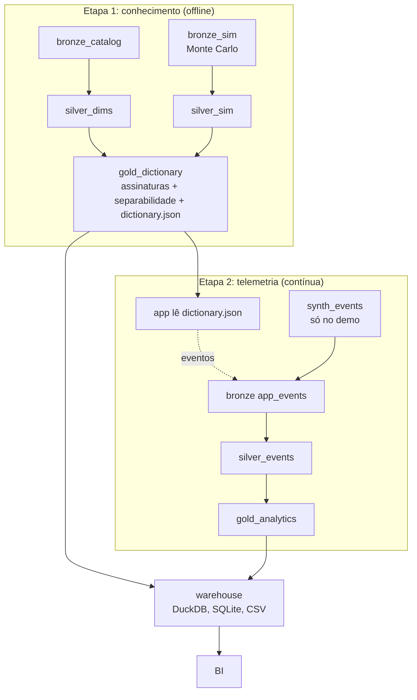

# Arquitetura

## Visão geral

O pipeline segue a arquitetura medalhão. Cada camada tem um contrato claro e só lê da camada anterior.

A ordem importa: o app precisa do dicionário **antes** de gerar eventos. Por isso a camada gold tem duas etapas (`gold_dictionary` e `gold_analytics`).

## Etapas do orquestrador

`python -m eletrodiag.pipeline.run` executa, em ordem:

| Etapa | Lê | Escreve |
|---|---|---|
| `bronze_catalog` | biblioteca de circuitos | `bronze/catalog/` |
| `bronze_sim` | simulador | `bronze/sim_runs/` |
| `silver_dims` | catálogo | `silver/dim_*` |
| `silver_sim` | `sim_runs` | `silver/sim_runs/` (particionada por circuito) |
| `gold_dictionary` | silver sim + dims | assinaturas, separabilidade, `gold/app/dictionary.json` |
| `synth_events` | dicionário | `bronze/app_events/`, `bronze/scenario_truth/` (apenas no demo) |
| `silver_events` | bronze eventos | sessões, medições, testes, diagnósticos, quarentena |
| `gold_analytics` | silver + dicionário | fatos, dimensões e agregações |
| `warehouse` | gold + metadados | DuckDB, SQLite, CSV |
| `app` | dicionário | `app/index.html` |
| `dashboard` | gold | `bi/dashboard/index.html` |

Cada etapa registra início, fim e duração em `data/_meta/runs.jsonl`, e as regras de qualidade em `data/_meta/dq_results.jsonl`. Ambos viram tabelas do warehouse (`fct_pipeline_run`, `fct_dq_result`).

## Contratos por camada

### Bronze

- Formato: JSON Lines (eventos e simulações) e JSON (catálogo).
- Partição: `ingest_date=AAAA-MM-DD/batch_id=<id>/`.
- Cada lote tem `_manifest.json` com origem, versão do esquema, número de linhas e SHA-256 dos arquivos.
- **Append-only.** Reprocessar cria um novo lote. A silver resolve duplicidade mantendo o lote mais recente.
- Eventos do app ficam intactos, inclusive linhas inválidas.

### Silver

- Formato: Parquet.
- Tipos e unidades normalizados (tensão em V, corrente em A, instantes em UTC).
- Chaves únicas (`session_id`, `event_id`, `session_id + step`).
- Linhas rejeitadas vão para `silver/_quarantine/<dataset>/<run_id>.parquet` com `reason`, `batch_id`, `line_no` e o dado original.
- Full-refresh idempotente: rodar duas vezes dá o mesmo resultado (há teste).

### Gold

- Modelo dimensional: dimensões (`dim_*`), fatos (`fct_*`) e agregações prontas para BI (`agg_*`).
- A gold também publica o artefato que alimenta o app (`dictionary.json`, com versão calculada por hash do conteúdo).
- `fct_session_step` **reexecuta o posterior** do diagnóstico para cada medição registrada. Assim a curva de convergência usa exatamente o que o app calcularia.

## Por que estas escolhas

| Decisão | Motivo | Quando mudar |
|---|---|---|
| Python + pandas + Parquet | Volume pequeno (dezenas de milhares de linhas), zero infraestrutura, fácil de rodar e testar | Passar de dezenas de milhões de eventos: Spark, ou DuckDB/Polars em lote maior |
| DuckDB e SQLite como warehouse | Arquivo único, SQL padrão, portátil, suportado por muitas ferramentas de BI | Vários analistas simultâneos: Postgres, BigQuery, Snowflake ou Databricks |
| Orquestração por CLI | Simples e determinística | Agendamento e dependências entre equipes: Airflow ou Dagster (cada etapa já é uma função) |
| Transformações em Python | Poucas, e algumas usam o motor de diagnóstico | Gold em SQL puro: dbt |
| Full-refresh | Mais simples e correto no volume atual | Volume crescente: incremental por `ingest_date`/`batch_id` (a bronze já está particionada para isso) |
| `sim_runs` particionada por circuito | Leitura seletiva e paralelismo | — |

## Modelo de dados

Esquema estrela em torno de `fct_session` (1 linha por sessão):

- Dimensões: `dim_circuit`, `dim_mode` (método), `dim_level`, `dim_date`.
- Detalhe por passo: `fct_session_step`.
- Conhecimento do domínio: `dim_component`, `dim_observable`, `dim_fault`, `fct_fault_signature`, `fct_fault_pair_separability`.
- Agregações: `agg_kpi_circuit_mode`, `agg_kpi_overall_mode`, `agg_convergence`, `agg_confusion`, `agg_observable_usage`, `agg_daily_usage`.

As colunas de cada tabela estão em [data_dictionary.md](data_dictionary.md).

## Privacidade

O app não coleta dado pessoal. O estudante é identificado por um pseudônimo aleatório (`learner_id`, 12 caracteres hexadecimais, sem relação com nome ou e-mail). Antes de uso real: definir política de retenção, consentimento e, se houver menores, as exigências da LGPD.

## Segurança elétrica

Os circuitos básicos são de baixa tensão. Os blocos do inversor têm corrente muito alta e barramento de cerca de 360 V CC: cada circuito tem um campo `hazard` (aviso de segurança) exibido no app em destaque, e um campo `nota` com os limites do modelo. Qualquer expansão para equipamentos ligados à rede elétrica precisa dos mesmos avisos e de revisão de conteúdo por um profissional habilitado.
